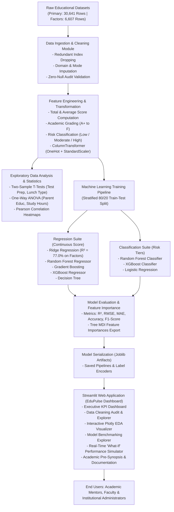

# Goel Institute of Technology & Management
### DEPARTMENT OF COMPUTER SCIENCE & ENGINEERING (AIML)
## MAJOR PROJECT PRE-SYNOPSIS

---

| Field | Details |
| :--- | :--- |
| **Proposed Project Title** | **Student Performance Analysis and Predictive Modeling Using Machine Learning and Interactive Educational Analytics Dashboard** |
| **Area of Work** | Data Analytics, Machine Learning, Educational Data Mining (EDM), Predictive Modeling, Interactive Decision Support Systems |
| **Type of Approach** | Software Based / Empirical Machine Learning Pipeline |

---

### 1. Team Details
* **Project Leader:** Prakhar Rai  
* **Roll No:** `2303601530038`  
* **Department:** Computer Science & Engineering (Artificial Intelligence & Machine Learning)  
* **Institution:** Goel Institute of Technology & Management, Lucknow  
* **Email:** `raiprakhar0123@gmail.com`  

---

### 2. Concepts / Ideas
Traditional higher education and secondary schooling evaluation systems evaluate student outcomes reactively—frequently after semester examinations when remedial interventions are often too late. **Student Performance Analysis & Predictive Modeling** is an intelligent, software-driven educational mining platform designed to analyze multidimensional student data and predict academic outcomes proactively.

By leveraging educational data mining (EDM) and machine learning algorithms, the system processes both granular behavioral factors (**class attendance percentage, weekly self-study hours, prior academic scores, tutoring support sessions, and sleep hygiene**) and demographic/socioeconomic parameters (**parental educational background, test preparation course completion, dietary/subsidy status, and extracurricular sports participation**). 

The platform identifies academic risk factors at an early stage, categorizes students into risk tiers (*Low Risk*, *Moderate Risk*, and *High Risk / Early Warning*), and delivers actionable recommendations through an interactive web-based decision support dashboard developed with **Streamlit**.

---

### 3. Project Objectives

1. **Large-Scale Data Curation & Preprocessing:**
   Acquire and preprocess a large-scale student benchmark dataset (**30,641 records** along with a specialized **6,607-record** behavioral factor dataset). Execute a systematic data cleaning pipeline including domain-guided imputation of missing values, string normalization, categorical encoding, and feature engineering (e.g., aggregate score calculation, academic grading tiers, and risk indices).

2. **Exploratory Data Analysis (EDA) & Statistical Hypothesis Testing:**
   Conduct rigorous exploratory and inferential statistical analyses—including Two-Sample Welch's $t$-tests and One-Way ANOVA—to quantitatively validate the statistical significance of key parameters such as test preparation course completion ($p < 0.001$, $t=39.48$), socioeconomic standing ($p < 0.001$, $t=58.02$), parental education ($F=250.89$), and study hours ($F=75.66$).

3. **Multi-Model Predictive Machine Learning Benchmarking:**
   Implement, tune, and evaluate multiple supervised machine learning architectures:
   - **Continuous Regression:** Ridge Regression, Decision Trees, Random Forest Regressor, Gradient Boosting, and XGBoost Regressor for predicting continuous examination scores.
   - **Multi-Class Classification:** Logistic Regression, Random Forest Classifier, and XGBoost Classifier for early warning categorization (*Low*, *Moderate*, *High Risk*).

4. **Model Interpretability & Feature Importance Mining:**
   Extract and rank global feature importances using Mean Decrease in Impurity (MDI) to uncover key performance drivers (e.g., class attendance contributing ~39.6% predictive weight, followed by self-study hours at ~24.9% and prior academic scores at ~8.1%).

5. **Deployment of an Interactive Streamlit Decision Support Dashboard:**
   Architect and deploy a multi-page, interactive Streamlit web application providing:
   - Dynamic KPI metric scorecards and filterable student record explorer.
   - Interactive Plotly visualizations for exploratory data analysis.
   - Real-time **"What-If" Student Performance Simulator** that allows educators and academic counselors to simulate how targeted improvements (e.g., boosting attendance to 90%+ or adding tutoring sessions) project measurable score and grade enhancements.

---

### 4. General Block Diagram & System Architecture

---

### 5. Technical Requirements

* **Hardware Requirements:**
  - **Processor:** Intel Core i5 / AMD Ryzen 5 or above (Multi-core recommended for tree ensemble parallel processing)
  - **RAM:** Minimum 8 GB (16 GB recommended for handling 30k+ records and interactive visualization caches)
  - **Storage:** Minimum 10 GB free SSD storage
  - **Network:** Active Internet connection for library dependencies and data fetching

* **Software & Development Environment:**
  - **Operating System:** Windows 10/11, Linux (Ubuntu 20.04+), or macOS
  - **Core Language:** Python 3.11+ / Python 3.13
  - **Data Processing & Scientific Libraries:** Pandas 2.x, NumPy, SciPy (Statistical Hypothesis Testing)
  - **Machine Learning Libraries:** Scikit-learn 1.6+, XGBoost 3.4+, Joblib
  - **Data Visualization:** Plotly 5.24+, Seaborn 0.13+, Matplotlib 3.10+
  - **Web Framework:** Streamlit 1.45+
  - **IDE & Version Control:** Visual Studio Code (VS Code), Git, GitHub

---

### 6. Idea Source & Academic References

1. **Cortez, P., & Silva, A. (2008).** *Using Data Mining to Predict Secondary School Student Performance.* In Proceedings of 5th Annual Future Business Technology Conference (FUBUTEC 2008), Porto, Portugal, pp. 5–12.
2. **Romero, C., & Ventura, S. (2010).** *Educational Data Mining: A Review of the State of the Art.* IEEE Transactions on Systems, Man, and Cybernetics, Part C (Applications and Reviews), 40(6), 601–618.
3. **Baker, R. S. (2010).** *Data Mining for Education.* International Encyclopedia of Education, 7(3), 112–118.
4. **Kaggle Datasets & Benchmarks:** 
   - *Students Exam Scores: Extended Benchmark Dataset* (30,641 records, desalegngeb).
   - *Student Performance Factors Dataset* (6,607 records, comprehensive behavioral factors).
5. **Pedregosa, F., et al. (2011).** *Scikit-learn: Machine Learning in Python.* Journal of Machine Learning Research, 12, 2825–2830.
6. **Chen, T., & Guestrin, C. (2016).** *XGBoost: A Scalable Tree Boosting System.* In Proceedings of the 22nd ACM SIGKDD International Conference on Knowledge Discovery and Data Mining (KDD '16), pp. 785–794.
7. **Streamlit Documentation (2024).** *Interactive Web Application Architecture for Machine Learning and Data Science.* Available online at https://docs.streamlit.io/.

---
*Faculty Guidance:* **Self-Initiated Major Project (Department of CSE - AIML, Goel Institute of Technology & Management)**
